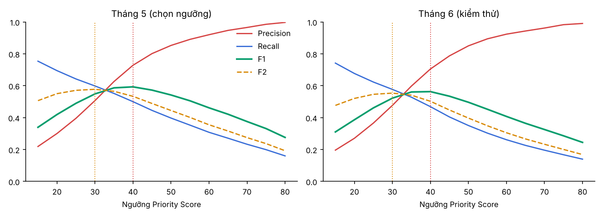
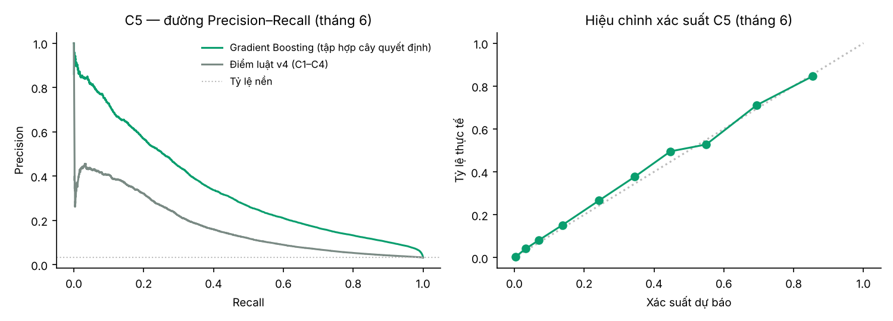
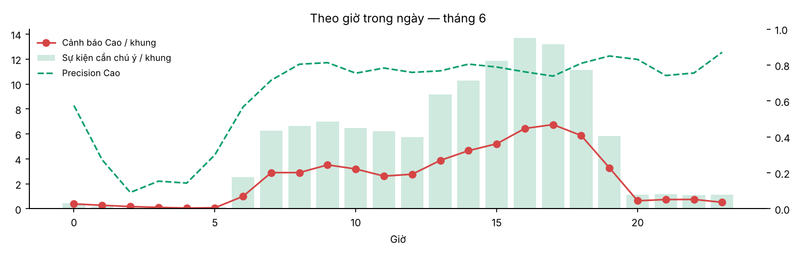
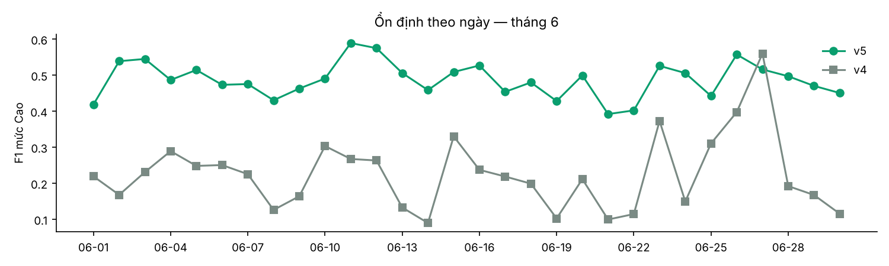

# Báo cáo đánh giá hệ hỗ trợ ra quyết định (DSS v5 — Luzern)

_Sinh tự động bởi `python -m utd19_dss.evaluate` lúc 2026-11-02T08:42:43 từ artifacts dựng lúc 2026-11-02T08:19:20._

## 1. Phương pháp đánh giá

- **Chia dữ liệu theo thời gian:** huấn luyện 2015-01-01 → 2015-04-30; kiểm định 2015-05-01 → 2015-05-31 (chọn mô hình, trọng số, ngưỡng); **kiểm thử 2015-06-01 → 2015-06-30** (dữ liệu phát lại live, chưa dùng khi dựng). Mọi số liệu dưới đây là của tháng 6 nếu không ghi khác.
- **Nhãn "cần chú ý":** detector có sự kiện ùn tắc bất thường (z occupancy ≥ 2 và occupancy cao hơn kỳ vọng ≥ 5 điểm %) ngay tại khung **hoặc** trong 30 phút sau. Tháng 6 có 14,593 detector-khung cần chú ý: 6,490 đang diễn ra và 8,103 chỉ xảy ra trong 30 phút tới.
- **Chỉ số:** Precision@10 (top 10 mỗi khung, đúng hướng sử dụng của bảng xếp hạng); precision / recall / F1 của mức Cao; recall tách thành sự kiện **đang diễn ra** (phát hiện) và **sắp xảy ra** (dự báo); PR-AUC cho mô hình C5.

## 2. Kết quả chính

- Ngưỡng triển khai: **Cao ≥ 40** (F1 lớn nhất trên tháng 5), **Trung bình ≥ 30** (F2 lớn nhất). Trọng số: C1 = 0.25, C2 = 0.05, C3 = 0.05, C4 = 0.15, C5 = 0.50.
- Mức Cao: precision **76.8%**, recall **37.1%**, F1 **0.500** (v4: 58.3% / 18.1% / 0.277), trung bình 2.45 cảnh báo Cao mỗi khung.
- Recall tách theo loại: mức Cao bắt **74.5%** sự kiện đang diễn ra và 7.2% sự kiện sắp xảy ra; tính cả mức Trung bình: 99.3% và 24.4%.
- Precision@10: **39.9%** (v4 34.5%).
- Năng lực ca trực: tối đa **10 cảnh báo Cao mỗi khung** (phần vượt chuyển sang hàng chờ, mức Trung bình). So với không giới hạn: F1 mức Cao 0.500 so với 0.563, precision 76.8% so với 70.5%, recall 37.1% so với 46.9%; số cảnh báo Cao lớn nhất trong một khung 10 so với 48.
- Mô hình C5 (Gradient Boosting): PR-AUC tháng 6 = **0.342** (Persistence 0.126, điểm luật v4 0.170; tỷ lệ nền ≈ 3.1%).
- Ổn định: F1 mức Cao theo ngày trung bình 0.487 ± 0.049; v5 tốt hơn v4 ở 29/30 ngày.
- Hiệu năng live: 4.2 ms để chấm một khung 15 phút cho 158 detector (p95 7.5 ms).

## 3. So sánh chiến lược ra quyết định

Mỗi chiến lược (trừ v4 gốc) được chọn ngưỡng trên tháng 5 bằng cùng quy tắc F1/F2, rồi đo trên tháng 6.

| Chiến lược | ngưỡng Cao/TB | P@10 | Cao/khung | Precision Cao | Recall Cao | F1 Cao | Recall Cao (đang diễn ra) | Recall Cao (sắp xảy ra) | Recall Cao+TB | Precision Cao+TB |
|---|---|---|---|---|---|---|---|---|---|---|
| v5 — đề xuất (C1–C5, trọng số tối ưu, ngưỡng F1/F2) | 40/30 | 39.9% | 2.45 | 76.8% | 37.1% | 0.5 | 74.5% | 7.2% | 57.7% | 47.7% |
| v5 không giới hạn năng lực ca trực | 40/30 | 39.9% | 3.37 | 70.5% | 46.9% | 0.563 | 88.8% | 13.3% | 57.7% | 47.7% |
| v4 — trọng số kinh nghiệm, ngưỡng 70/40 | 70/40 | 34.5% | 1.58 | 58.3% | 18.1% | 0.277 | 37.5% | 2.6% | 53.7% | 32.8% |
| v4 + ngưỡng chọn lại theo F1/F2 | 50/40 | 34.5% | 4.2 | 42.1% | 34.9% | 0.382 | 71.7% | 5.4% | 53.7% | 32.8% |
| v5 bỏ C5 (chỉ luật C1–C4) | 50/40 | 35.0% | 3.66 | 47.6% | 34.4% | 0.399 | 72.6% | 3.7% | 52.6% | 35.0% |
| Chỉ C5 (chỉ mô hình học máy) | 35/15 | 38.8% | 2.53 | 66.3% | 33.1% | 0.442 | 61.0% | 10.8% | 69.1% | 32.1% |
| Chỉ C1 (occupancy vượt baseline) | 70/60 | 35.6% | 3.79 | 49.2% | 36.9% | 0.422 | 79.0% | 3.1% | 49.7% | 40.1% |

**Đọc kết quả:** so v4 với "v4 + ngưỡng chọn lại" cho thấy riêng việc chọn ngưỡng có căn cứ đã cải thiện F1; so "v5 bỏ C5" với v5 cho thấy phần đóng góp của học máy, chủ yếu ở recall sự kiện sắp xảy ra.

### 3.0. Năng lực ca trực (tối đa N cảnh báo Cao mỗi khung)

| N | Cao/khung | Precision Cao | Recall Cao | Recall đang diễn ra | Recall sắp xảy ra | F1 Cao |
|---|---|---|---|---|---|---|
| không giới hạn | 3.37 | 70.5% | 46.9% | 88.8% | 13.3% | 0.563 |
| 5 | 1.71 | 80.1% | 27.0% | 55.8% | 3.9% | 0.404 |
| 8 | 2.21 | 78.0% | 34.1% | 69.0% | 6.1% | 0.474 |
| 10 | 2.45 | 76.8% | 37.1% | 74.5% | 7.2% | 0.500 |
| 12 | 2.62 | 76.0% | 39.3% | 78.3% | 8.1% | 0.518 |
| 15 | 2.82 | 74.7% | 41.6% | 82.0% | 9.3% | 0.534 |
| 20 | 3.04 | 73.6% | 44.1% | 85.8% | 10.7% | 0.551 |

Giới hạn cắt trước hết các cảnh báo sắp xảy ra (điểm thấp hơn cảnh báo đang ùn). N là biến quyết định của người quản lý ca, chỉnh được trên trang What-if.

### 3.1. Loại bỏ từng tiêu chí (ablation)

| Bỏ tiêu chí | Tên | P@10 | F1 Cao | Precision Cao | Recall Cao | Δ P@10 | Δ F1 Cao |
|---|---|---|---|---|---|---|---|
| C1 | Occupancy cao hơn thường lệ | 38.1% | 0.448 | 64.4% | 34.4% | -0.018 | -0.052 |
| C2 | Lưu lượng bất thường | 39.9% | 0.504 | 77.8% | 37.3% | 0.001 | 0.004 |
| C3 | Bất thường kéo dài | 39.9% | 0.502 | 77.3% | 37.2% | 0 | 0.002 |
| C4 | Ảnh hưởng từ detector lân cận | 40.0% | 0.516 | 72.0% | 40.2% | 0.001 | 0.015 |
| C5 | Nguy cơ ùn tắc 30 phút tới (ML) | 35.0% | 0.399 | 47.6% | 34.4% | -0.049 | -0.101 |

C5 là tiêu chí đóng góp lớn nhất; C1 đứng thứ hai. C2, C3, C4 gần như không đổi kết quả tổng hợp (|Δ F1| ≤ 0,015) vì thông tin của chúng đã có trong đặc trưng của C5; chúng vẫn được giữ với trọng số nhỏ vì bảng quyết định dùng chúng để chọn **loại** hành động (ùn kéo dài, ùn lan khu vực, nghi sự cố, tăng đột biến) và để người vận hành đọc được lý do.

## 4. Chọn ngưỡng

Tháng 5 (dùng để chọn):

| Ngưỡng | Cảnh báo/khung | Precision | Recall | Recall đang diễn ra | Recall sắp xảy ra | F1 | F2 |
|---|---|---|---|---|---|---|---|
| 15 | 21.11 | 21.9% | 75.4% | 100.0% | 54.6% | 0.339 | 0.506 |
| 20 | 14.19 | 30.0% | 69.5% | 100.0% | 43.7% | 0.419 | 0.55 |
| 25 | 9.95 | 39.6% | 64.2% | 100.0% | 34.1% | 0.49 | 0.571 |
| 30 | 7.24 | 50.7% | 59.8% | 99.6% | 26.3% | 0.549 | 0.578 |
| 35 | 5.4 | 62.6% | 55.2% | 97.0% | 19.9% | 0.587 | 0.565 |
| 40 | 4.21 | 72.8% | 50.0% | 91.5% | 15.0% | 0.593 | 0.533 |
| 45 | 3.41 | 80.1% | 44.5% | 84.3% | 11.0% | 0.573 | 0.489 |
| 50 | 2.86 | 85.3% | 39.7% | 76.8% | 8.5% | 0.542 | 0.445 |
| 55 | 2.43 | 89.1% | 35.3% | 69.7% | 6.3% | 0.505 | 0.401 |
| 60 | 2.05 | 92.0% | 30.8% | 62.2% | 4.3% | 0.461 | 0.355 |
| 65 | 1.75 | 94.7% | 27.1% | 55.8% | 2.9% | 0.421 | 0.316 |
| 70 | 1.48 | 96.5% | 23.3% | 48.9% | 1.8% | 0.375 | 0.275 |
| 75 | 1.24 | 98.5% | 19.9% | 42.8% | 0.6% | 0.331 | 0.237 |
| 80 | 0.99 | 99.7% | 16.0% | 34.9% | 0.1% | 0.276 | 0.192 |

Tháng 6 (kiểm chứng):

| Ngưỡng | Cảnh báo/khung | Precision | Recall | Recall đang diễn ra | Recall sắp xảy ra | F1 | F2 |
|---|---|---|---|---|---|---|---|
| 15 | 19.16 | 19.6% | 74.2% | 100.0% | 53.5% | 0.31 | 0.477 |
| 20 | 12.68 | 27.1% | 67.7% | 100.0% | 41.8% | 0.387 | 0.52 |
| 25 | 8.63 | 36.6% | 62.3% | 100.0% | 32.1% | 0.461 | 0.546 |
| 30 | 6.13 | 47.7% | 57.7% | 99.3% | 24.4% | 0.522 | 0.554 |
| 35 | 4.47 | 59.8% | 52.8% | 95.9% | 18.3% | 0.561 | 0.541 |
| 40 | 3.37 | 70.5% | 46.9% | 88.8% | 13.3% | 0.563 | 0.502 |
| 45 | 2.6 | 78.7% | 40.4% | 79.1% | 9.5% | 0.534 | 0.448 |
| 50 | 2.09 | 85.0% | 35.0% | 70.2% | 6.9% | 0.496 | 0.397 |
| 55 | 1.72 | 89.4% | 30.3% | 62.0% | 4.9% | 0.452 | 0.349 |
| 60 | 1.43 | 92.3% | 26.1% | 54.2% | 3.7% | 0.407 | 0.305 |
| 65 | 1.21 | 94.3% | 22.6% | 47.5% | 2.6% | 0.364 | 0.266 |
| 70 | 1.03 | 96.2% | 19.6% | 41.9% | 1.7% | 0.325 | 0.233 |
| 75 | 0.86 | 98.3% | 16.7% | 36.7% | 0.8% | 0.286 | 0.201 |
| 80 | 0.71 | 99.0% | 14.0% | 31.0% | 0.3% | 0.245 | 0.169 |

Hạ ngưỡng làm tăng recall nhưng precision giảm nhanh; F1 đạt đỉnh ở ngưỡng Cao đã chọn và vị trí đỉnh trên tháng 6 gần với tháng 5, tức là lựa chọn không bị khớp riêng cho tháng 5. Phần recall còn thiếu gần như toàn bộ là sự kiện **sắp xảy ra**: sự kiện đang diễn ra được bắt gần đủ, còn dự báo 15–30 phút trước bị giới hạn bởi độ khó của bài toán (mục 5).

## 5. Mô hình học máy C5

| Mô hình | Tập | PR-AUC | ROC-AUC | Precision | Recall | F1 | Recall sự kiện mới | Brier |
|---|---|---|---|---|---|---|---|---|
| Decision Tree | valid (T5) | 0.322 | 0.885 | 38.9% | 37.3% | 0.381 | 15.9% | 0.029 |
| Naive Bayes | valid (T5) | 0.21 | 0.851 | 31.7% | 37.0% | 0.341 | 13.3% | 0.077 |
| Neural Network (MLP) | valid (T5) | 0.353 | 0.897 | 39.0% | 38.6% | 0.388 | 17.5% | 0.028 |
| Gradient Boosting | valid (T5) | 0.378 | 0.913 | 39.6% | 40.6% | 0.401 | 20.9% | 0.028 |
| Mốc Persistence | valid (T5) | 0.146 | 0.63 | 44.0% | 27.3% | 0.337 | 0.0% | 0.039 |
| Mốc điểm luật v4 | valid (T5) | 0.205 | 0.772 | 27.9% | 28.9% | 0.284 | 5.6% | 0.051 |
| Gradient Boosting | test (T6) | 0.342 | 0.907 | 37.4% | 36.2% | 0.368 | 18.1% | 0.025 |
| Mốc Persistence | test (T6) | 0.126 | 0.619 | 41.2% | 24.9% | 0.311 | 0.0% | 0.035 |
| Mốc điểm luật v4 | test (T6) | 0.17 | 0.766 | 25.6% | 26.6% | 0.26 | 6.4% | 0.05 |

Hiệu chỉnh xác suất trên tháng 6:

| Khoảng xác suất | Số mẫu | Xác suất TB | Tỷ lệ thực tế |
|---|---|---|---|
| 0.00–0.02 | 244242 | 0.4% | 0.4% |
| 0.02–0.05 | 48677 | 3.2% | 4.1% |
| 0.05–0.10 | 26282 | 7.0% | 8.1% |
| 0.10–0.20 | 13437 | 13.8% | 15.2% |
| 0.20–0.30 | 3803 | 24.2% | 26.6% |
| 0.30–0.40 | 1729 | 34.5% | 37.7% |
| 0.40–0.50 | 1019 | 44.7% | 49.6% |
| 0.50–0.60 | 709 | 54.9% | 52.8% |
| 0.60–0.80 | 996 | 69.4% | 71.1% |
| 0.80–1.00 | 317 | 85.4% | 84.5% |

Xác suất dự báo bám sát tỷ lệ thực tế, nên có thể dùng trực tiếp làm "P(ùn trong 30′)" trên giao diện. PR-AUC thấp hơn 0,5 là đặc thù của bài toán hiếm (tỷ lệ nền vài %): mức hiện tại cao hơn ngẫu nhiên khoảng 10 lần và hơn 2,5 lần mốc Persistence. Đã thử thêm đặc trưng (z cùng khung hôm trước/tuần trước, thống kê trượt 1–2 giờ, lân cận, tỷ lệ sự kiện lịch sử) và nhãn trung bình 30 phút nhưng không cải thiện; cần dữ liệu ngoài (sự cố, công trường, tín hiệu đèn, thời tiết).

## 6. Theo thời gian và chất lượng dữ liệu

| Giờ | Sự kiện/khung | Cao/khung | Precision Cao | Recall Cao | Thiếu dữ liệu |
|---|---|---|---|---|---|
| 0 | 0.46 | 0.39 | 57.5% | 49.1% | 35.3% |
| 1 | 0.17 | 0.28 | 27.3% | 45.0% | 40.8% |
| 2 | 0.07 | 0.18 | 9.1% | 25.0% | 41.5% |
| 3 | 0.03 | 0.11 | 15.4% | 50.0% | 44.0% |
| 4 | 0.03 | 0.06 | 14.3% | 25.0% | 45.5% |
| 5 | 0.16 | 0.08 | 30.0% | 15.8% | 33.5% |
| 6 | 2.56 | 1 | 56.7% | 22.1% | 21.9% |
| 7 | 6.28 | 2.9 | 71.5% | 33.0% | 19.9% |
| 8 | 6.65 | 2.9 | 80.5% | 35.1% | 18.0% |
| 9 | 6.97 | 3.52 | 81.3% | 41.1% | 17.2% |
| 10 | 6.47 | 3.19 | 75.5% | 37.2% | 17.2% |
| 11 | 6.21 | 2.62 | 78.3% | 33.0% | 17.2% |
| 12 | 5.76 | 2.77 | 75.9% | 36.5% | 17.1% |
| 13 | 9.18 | 3.88 | 76.8% | 32.4% | 17.1% |
| 14 | 10.3 | 4.66 | 80.5% | 36.4% | 17.2% |
| 15 | 11.88 | 5.21 | 78.9% | 34.6% | 17.2% |
| 16 | 13.72 | 6.44 | 76.2% | 35.8% | 17.1% |
| 17 | 13.17 | 6.75 | 73.8% | 37.9% | 17.2% |
| 18 | 11.13 | 5.87 | 81.0% | 42.7% | 17.2% |
| 19 | 5.85 | 3.28 | 85.0% | 47.7% | 17.2% |
| 20 | 1.15 | 0.64 | 83.1% | 46.4% | 17.7% |
| 21 | 1.17 | 0.74 | 74.2% | 47.1% | 18.4% |
| 22 | 1.11 | 0.75 | 75.6% | 51.1% | 19.2% |
| 23 | 1.14 | 0.52 | 87.1% | 39.4% | 23.8% |

| Tier | Detector | Sự kiện | Precision Cao | Recall Cao | Thiếu dữ liệu |
|---|---|---|---|---|---|
| A | 99 | 12178 | 77.6% | 38.5% | 17.0% |
| B | 15 | 910 | 79.4% | 31.8% | 33.5% |
| C | 29 | 1505 | 68.1% | 29.0% | 1.9% |
| X | 15 | 0 | 0.0% | 0.0% | 100.0% |

## 7. Gợi ý hành động ở mức Cao

| Mã | Hành động | Số cảnh báo | Tỷ trọng | Precision |
|---|---|---|---|---|
| INTERVENE | Can thiệp | 3550 | 50.4% | 81.0% |
| PERSIST | Ùn kéo dài | 2348 | 33.3% | 82.0% |
| VERIFY | Xác minh thiết bị | 642 | 9.1% | 68.1% |
| EARLY | Cảnh báo sớm | 508 | 7.2% | 35.0% |

## 8. Kết luận và hạn chế

- DSS v5 cải thiện so với v4 ở mọi chỉ số tổng hợp chính trên dữ liệu chưa thấy (F1 mức Cao 0.500 so với 0.277; P@10 39.9% so với 34.5%).
- Phát hiện bất thường đang diễn ra gần như đầy đủ; dự báo trước 30 phút mới bắt được một phần — đây là giới hạn chính, do nhãn 15 phút nhiễu và thiếu dữ liệu nguyên nhân.
- Khung đêm (00–05 giờ) thiếu dữ liệu nhiều do khoảng đo bị gắn error tập trung khi lưu lượng ≈ 0.
- Đánh giá dùng nhãn thống kê, chưa đối chiếu với nhật ký sự cố thực; mới kiểm thử trên một tháng (6/2015). Khi có dữ liệu mùa khác cần chạy lại build và đánh giá.
- **Lưu ý khi đọc recall “đang diễn ra”:** nhãn sự kiện và tiêu chí C1 cùng dựa trên z occupancy so với baseline, nên mức Cao bắt gần hết sự kiện đang diễn ra một phần là do cách định nghĩa (gần như tất yếu). Giá trị gia tăng thật của DSS nằm ở recall sự kiện **sắp xảy ra**, Precision@10 và PR-AUC của C5 so với mốc Persistence.
- **Rò rỉ thông tin ở giai đoạn kiểm định (đã khắc phục ở v5.1):** tier chất lượng, cụm detector K-means và ma trận lân cận dùng khi chọn mô hình/trọng số/ngưỡng giờ chỉ tính trên 01/01–30/04; giai đoạn cuối dùng 01/01–31/05.
- **Năng lực ca trực (đã xử lý ở v5.1):** không giới hạn thì giờ cao điểm có khung tới 48 cảnh báo Cao; nay giữ tối đa 10 cảnh báo/khung, phần vượt vào hàng chờ. Cái giá là recall thấp hơn, chủ yếu ở sự kiện sắp xảy ra (mục 3.0).
